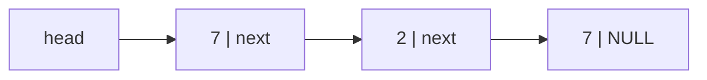

# D01 단일 연결 리스트: 순회와 첫 일치 검색

## 개요와 목표
예상 25분. 값과 다음 노드의 주소를 묶어 순서 있는 자료를 표현한다.
배열과 달리 이웃 노드가 연속된 메모리에 있다는 보장은 없다.
선수 지식: 반복문, NULL, 구조체, 포인터, 구조체 배열 검색.
끝나면 next를 따라 순회하고, 첫 일치 노드의 주소를 반환할 수 있다.

## 왜 연결하는가
각 노드는 값과 연결을 가진다. 배열의 인덱스 대신 다음 주소가 순서를 정한다.
중간 연결을 바꿀 수 있다는 장점은 있지만, 임의 위치 접근은 순회를 요구한다.
이번에는 읽기만 배운다. 삽입·삭제·malloc/free와 소유권 이전은 D05에서 다룬다.

## 노드와 수명 계약
`struct Node { int value; const struct Node *next; };`는 선언 조각이다.
next가 NULL이면 마지막 노드다. head가 NULL이면 빈 리스트다.
호출자는 검색이 끝날 때까지 살아 있는, 유한하며 순환이 없는 노드들을 제공한다.
잘못된 주소나 순환을 이 함수가 복구해 주지는 않는다.
함수는 값과 연결을 바꾸거나 해제하지 않고, 반환 주소의 소유권도 가져오지 않는다.

## 독자 정적 도식

화살표는 주소 연결이지 메모리 간격이 아니다. 첫 7과 마지막 7은 값은 같아도 다른 객체다.

## 순회: 현재 위치만 옮기기
현재 위치 p를 head로 시작한다. p가 NULL이 아닐 때만 p의 멤버를 읽는다.
값을 확인한 뒤 `p = p->next`로 이동한다. `p++`는 연결을 따르지 않는다.
head 자체를 수정할 필요가 없으므로 다른 검색도 같은 시작점을 사용할 수 있다.

## 첫 일치와 반환값
현재 값이 target이면 즉시 그 노드의 주소를 반환한다. 끝까지 없으면 NULL이다.
복사본의 주소나 지역 변수의 주소가 아니다. 호출자가 준 노드의 정확한 주소여야 한다.
NULL은 발견 못 함이므로 결과를 역참조하기 전에 확인한다.

## 완성 프로그램과 실제 출력
다음 블록은 조각이 아니라 main을 포함한 완성 프로그램이다.
```c
#include <stddef.h>
#include <stdio.h>

struct Node { int value; const struct Node *next; };

const struct Node *list_find(const struct Node *head, int target) {
    for (const struct Node *p = head; p != NULL; p = p->next) {
        if (p->value == target) return p;
    }
    return NULL;
}

int main(void) {
    struct Node last = {7, NULL};
    struct Node middle = {2, &last};
    struct Node first = {7, &middle};
    for (const struct Node *p = &first; p != NULL; p = p->next) {
        printf("%d%s", p->value, p->next == NULL ? "\n" : " ");
    }
    puts(list_find(&first, 7) == &first ? "first" : "wrong");
    puts(list_find(&first, 5) == NULL ? "missing" : "wrong");
    return 0;
}
```
컴파일: `gcc -std=c11 -Wall -Wextra -Werror -Wpedantic example.c -o example`
출력은 `7 2 7`, `first`, `missing`의 세 줄이다.
next 순서로 출력하고 첫 7에서 멈추며, 5는 끝까지 없기 때문이다.

## 중간 점검과 퀴즈
1. 빈 리스트에서 value를 먼저 읽어도 될까? 아니다. NULL 확인이 먼저다.
2. 중복 7에서 어느 주소인가? head에서 출발해 처음 만난 7의 주소다.
3. p++로 다음 노드에 갈 수 있을까? 아니다. p->next를 사용한다.

## 흔한 오류와 수정
- 마지막 노드를 건너뜀: `p->next != NULL`만 반복 조건으로 쓰지 않는다.
- 중복의 마지막 주소를 반환함: 일치 순간 반환한다.
- 값은 맞지만 복사본 주소를 반환함: 노드의 정체성과 수명을 구별한다.
- 이전 검색 위치를 static에 저장함: 호출마다 head에서 다시 시작한다.
- 검색하면서 연결을 바꿈: 읽기 계약 위반이다. 입력 노드들은 보존한다.

## 직접 풀기와 테스트
기초: 제공된 구조체 선언과 같은 형식으로 list_find 함수만 작성한다. main/출력은 제출하지 않는다.
응용: 빈 리스트, 하나뿐인 노드의 일치/미일치, 첫·중간·끝, 미발견을 손으로 추적한다.
도전: 중복 값과 INT_MIN/INT_MAX에서도 비교만 사용하여 올바른 주소를 고른다.
10개 채점 사례는 위 경계와 서로 떨어진 연결 순서, 반복 호출을 검사한다.
공개 사례 ‘첫 노드’의 출력 1은 하네스가 주소 동일성과 입력 보존을 확인했다는 뜻이며, 함수 자체의 반환값은 노드 주소다.
값/next 보존도 확인한다. 실패한 사례의 입력과 반환 주소를 먼저 추적한 뒤 수정·재제출한다.
현재 이 원고와 채점 계약은 준비 단계이며 학습 화면 연결은 다음 작업이다.

## Mini Project와 복습
위 완성 프로그램에 목표 2 검색을 추가하고 결과가 middle의 주소인지 확인한다.
탐색의 최악 시간은 노드 n개에 O(n), 추가 공간은 O(1)이다.
핵심 요약: NULL 확인 → 값 비교 → next 이동, 발견 시 즉시 반환, 입력은 그대로.
복습 때 빈 리스트와 중복 사례를 다시 풀고, 다음 D02의 스택 순서와 비교한다.
이론·퀴즈·실습 통과는 별개다. 화면 및 실제 제출 흐름 검증 전에는 이 단원의 숙달을 선언하지 않는다.
